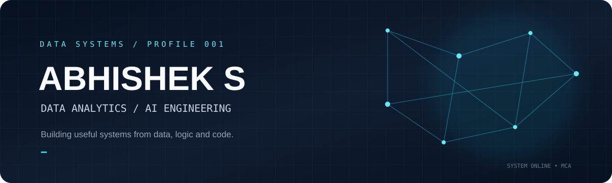
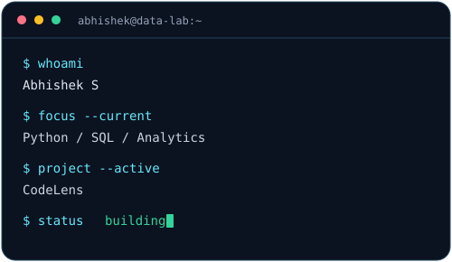
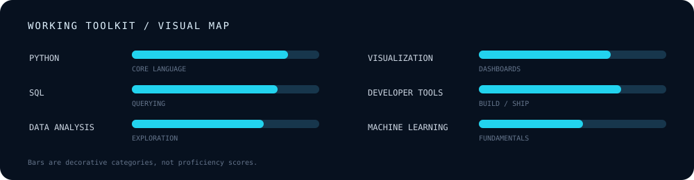
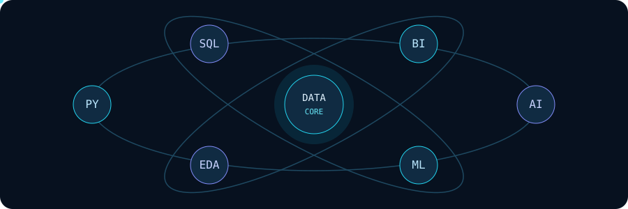
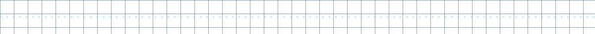
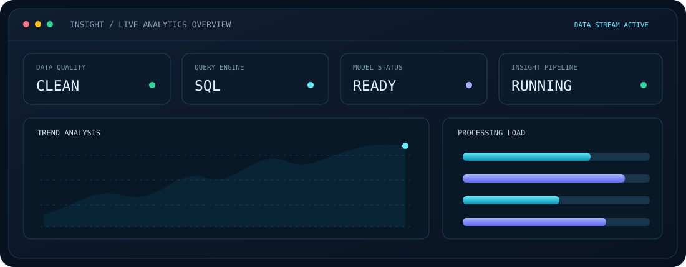
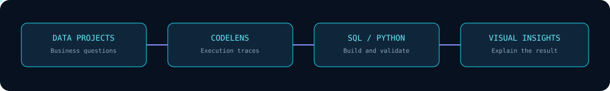
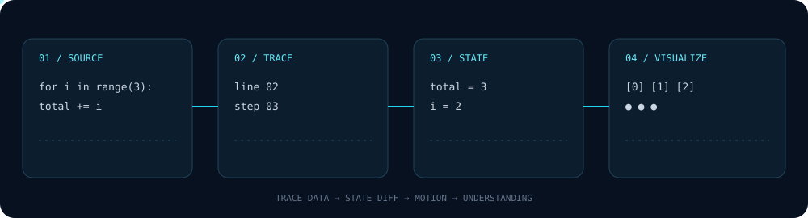
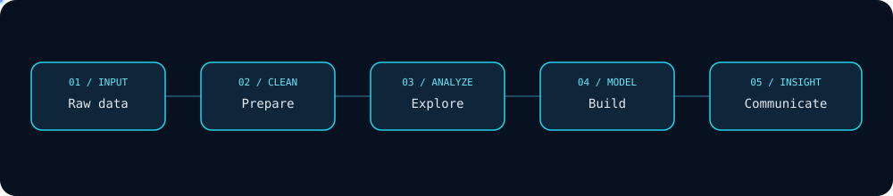

<!--
  ABHISHEK S | GitHub Profile README
  Theme: DATA SYSTEMS / AI ENGINEERING
  Custom animated SVG assets are included in /assets.
  Profile links and public project repositories have been updated.
-->

<div align="center">



<br/>


<br/>

<a href="https://github.com/Abhi-109">
  
</a>
<a href="mailto:abhimalnad9@gmail.com">
  
</a>

<br/>


</div>

---

## `01 / SYSTEM OVERVIEW`



```yaml
name: Abhishek S
current_focus:
  - Data Analytics
  - Python and SQL
  - AI-powered developer tools
  - Data visualization
education: Master of Computer Applications (MCA)
based_in: Karnataka, India
currently_building: CodeLens
approach: Learn -> Build -> Measure -> Improve
```

I am an MCA student focused on building practical software and data projects. My work sits at the intersection of **data analytics, programming, visualization and AI-assisted tools**.

I enjoy taking a problem from raw data or an initial idea, structuring it, building a working solution and making the result understandable.

**Current direction:** strengthen my foundations in analytics and software engineering while building tools that make complex technical concepts easier to understand.

<br clear="right"/>


## `02 / TECHNOLOGY MATRIX`

<div align="center">


<br/>


### Languages & Data


### Analytics & Visualization


### Development Tools


</div>

| Area | Tools / Concepts |
|:--|:--|
| Programming | Python |
| Data analysis | Pandas, NumPy, data cleaning, EDA |
| Databases | MySQL, joins, CTEs, window functions |
| Visualization | Power BI, Matplotlib, Streamlit |
| Statistics & ML | Descriptive statistics, feature engineering, ML fundamentals |
| Development | Git, GitHub, VS Code, Docker fundamentals |



## `03 / FEATURED BUILDS`

<div align="center">

<br/>

</div>

<table>
<tr>
<td width="50%" valign="top">

### ◈ CodeLens
**Code Execution Visualization**

A programming visualization project designed to make code execution easier to understand through synchronized visual representations.

- Step-by-step execution tracing
- Variables and data structure changes
- Call stack and execution flow
- Animation-driven learning experience

**Stack:** Python · JavaScript · React

<a href="https://github.com/Abhi-109/codelens">Repository</a>

</td>
<td width="50%" valign="top">

### ◈ Olist E-Commerce SQL Analytics
**Relational Data Analysis**

An SQL analytics project using the Olist e-commerce dataset to explore business and operational patterns.

- Relational data exploration
- Joins, CTEs and window functions
- Business-focused SQL analysis
- Structured analytical queries

**Stack:** MySQL · SQL

<a href="https://github.com/Abhi-109/olist-sql-analytics">Repository</a>

</td>
</tr>
<tr>
<td width="50%" valign="top">

### ◈ Logistics Last-Mile Analytics
**Route Deviation Analysis**

An analytics project exploring last-mile delivery route deviations and operational patterns.

- Data cleaning and feature engineering
- Route-level analysis
- Deviation categorization
- Dashboard-oriented insights

**Stack:** Python · Pandas · Power BI

<a href="https://github.com/Abhi-109/last-mile-route-deviation-analytics">Repository</a>

</td>
<td width="50%" valign="top">

### ◈ Retail Sales Forecasting
**Retail Analytics Project**

A public repository focused on retail sales forecasting and data analytics.

- Retail sales forecasting project
- Analytics-focused repository structure
- Data and analysis resources

**Stack:** Python

<a href="https://github.com/Abhi-109/Retail-Sales-Forecasting">Repository</a>

</td>
</tr>
</table>

> Project links were checked against the public repositories under [Abhi-109](https://github.com/Abhi-109).


## `04 / HOW I BUILD`

<div align="center">

<br/>

</div>

My usual workflow:

1. **Understand** the problem and define what needs to be answered.
2. **Inspect** the data, schema, constraints or existing code.
3. **Prepare** clean data and a reproducible workflow.
4. **Analyze / Implement** using the simplest suitable tools.
5. **Visualize** the result so the underlying behavior is understandable.
6. **Validate** outputs instead of trusting that a successful run means the work is correct.


## `05 / EDUCATION & CREDENTIALS`

### Master of Computer Applications (MCA)
Currently pursuing MCA.

### Certification
- **TCS iON:** Practical Approach on Data Mining and Analytics


## `06 / GITHUB ACTIVITY`

<div align="center">

<!-- Lightweight GitHub metrics using Shields.io, avoiding unreliable stats-card hosts. -->
<a href="https://github.com/Abhi-109">
  
</a>
<a href="https://github.com/Abhi-109?tab=repositories">
  
</a>
<a href="https://github.com/Abhi-109">
  
</a>

<br/><br/>


<br/><br/>

<a href="https://github.com/Abhi-109?tab=repositories">
  
</a>

</div>


<div align="center">

**BUILD • ANALYZE • VISUALIZE • REPEAT**

*Thanks for visiting my profile.*

</div>
